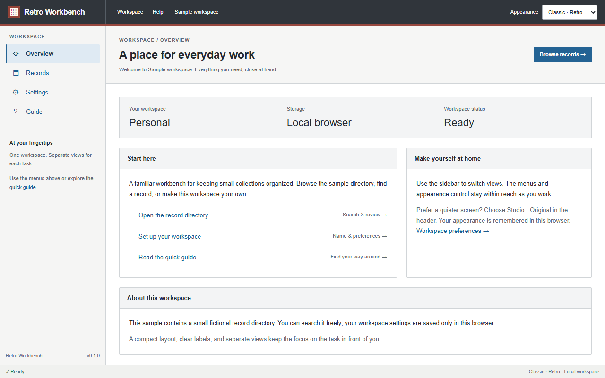
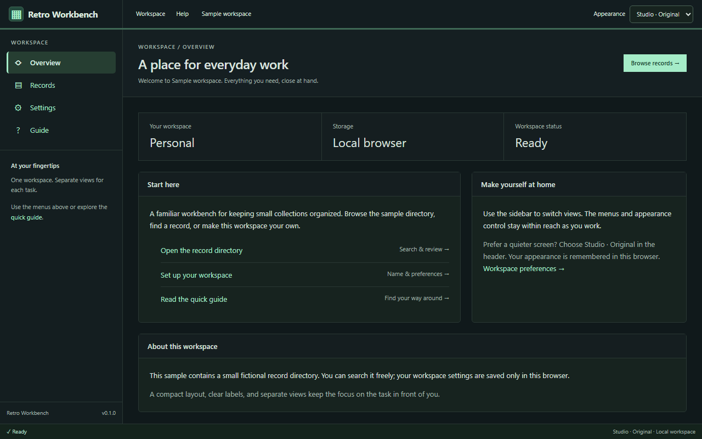
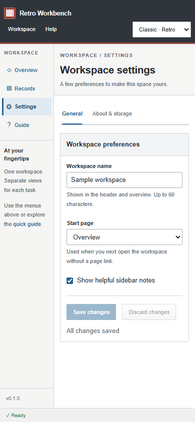
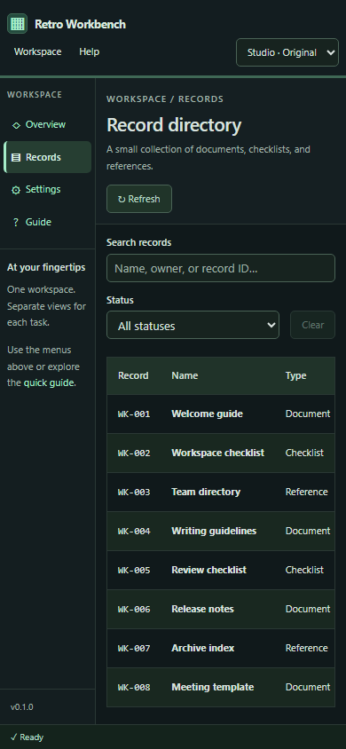

# Validation evidence

Validated on 2026-10-27, Windows, Node.js 22.14.0, npm 10.9.2.

## Completed checks

| Check                      | Result                                                                             |
| -------------------------- | ---------------------------------------------------------------------------------- |
| `npm run format:check`     | Passed                                                                             |
| `npm run typecheck`        | Passed; strict, unchecked-index, exact-optional and unused checks enabled          |
| `npm run check:boundaries` | Passed; layers, public entry points, browser access, external imports and cycles   |
| `npm test`                 | 8 tests passed                                                                     |
| `npm run build`            | Passed; 47 modules, approximately 241 kB JS / 75 kB gzip and 14 kB CSS / 4 kB gzip |
| `npm run test:e2e`         | 22 tests passed against the production build                                       |
| Full `npm run check`       | Passed after the responsive scrolling correction                                   |

The browser matrix uses Chromium at **1280 × 800** and **390 × 844**. It covers
Classic default and saved appearance; route changes, history and unknown-page
recovery; records search/status filters/empty state; loading, HTTP error, malformed
response and retry; older requests arriving after newer searches; form validation,
discard, saving, persisted start page, and draft retention across theme/tab changes;
blocked and corrupt storage; keyboard tabs, menus and skip link; no document or
main-pane horizontal overflow; and keyboard scrolling inside narrow tables.

Unit tests cover integration validation/cancellation/storage fallback plus negative
boundary-check fixtures (reverse dependencies, feature internals, sibling imports,
re-exports, dynamic imports, browser access and circular dependencies).

## Browser and visual review

Streamweave's Classic and Studio appearances were opened in the browser and compared
with this starter. The source's 224px sidebar, charcoal Classic header, red header
rule, light workspace, blue navigation, pale selected rows, square panels, compact
buttons, and Studio dark green palette were retained.

Both starter appearances were inspected interactively. Navigation and settings saves
were exercised in the browser. Desktop and narrow screenshots for all four pages
were generated by the test suite; the narrow overview, forms and records views were
visually inspected for readable wrapping, persistent navigation, and sensible scroll
ownership. An initial narrow-table overflow was fixed by constraining the page grid
track; regression tests now verify both main-pane and table scrolling.

Selected evidence is committed below. All page/theme screenshots are regenerated
under `test-results/` and retained by CI.

## Maintainability review

- Composition is limited to `app`; UI has no feature or integration imports.
- Features have no sibling dependencies. Records rendering, request lifecycle and
  columns have separate owners. Settings state remains local until a successful
  save updates the two shell consumers.
- Theme differences are token values, not duplicate component implementations.
- The Guide demonstrates adding a feature and registry entry without shell changes.
- No general state framework, runtime plugin system, canvas engine, workers, core
  calculation package, chart package or business datasets were carried over.
- Interfaces use native props, typed columns, explicit callbacks and slots. No
  components switch between unrelated jobs through collections of boolean flags.
- Dependencies are pinned; only React and React DOM ship as runtime dependencies.
- Streamweave remained clean at commit
  `8d813c1b64e96405a2b9fcbe8425a54f167b5e87` after source inspection and browser review.

## Limits of this evidence

Automated browser coverage is Chromium only. Firefox, WebKit, physical touch
devices, and screen readers were not tested. Narrow-layout evidence combines real
browser automation with screenshot review; it is not a physical-device test.
No claim of a formal accessibility audit is made. The demo intentionally has no
authentication, backend, large-table virtualization, cross-tab synchronization or
offline caching. Page-local unsaved drafts reset on navigation, as documented in
the customization guide.

GitLab CI is configured to run the same complete check on pushes. Consult the
repository's pipeline page for remote execution status; the results above are the
completed local checks.
